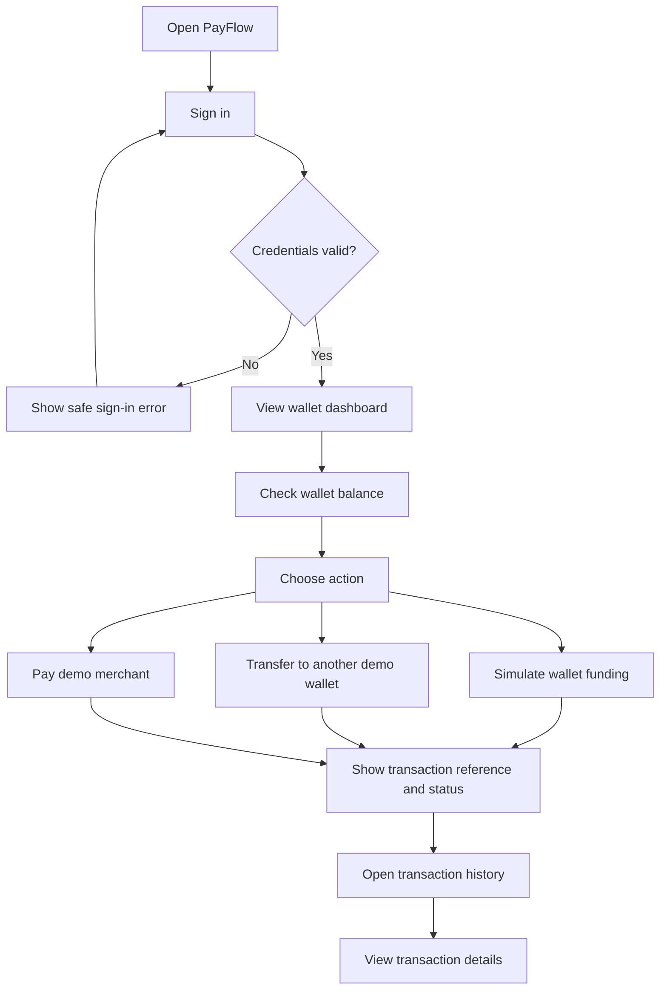

# PayFlow Customer User Journey

**Document ID:** PF-UJ-CUST-001  
**Version:** 1.0

## 1. Persona

**Name:** Ada (fictional)  
**Role:** PayFlow customer  
**Goal:** Fund a demo wallet, transfer funds and pay a merchant.

## 2. Happy-path journey

## 3. Step-by-step journey

| Step | Customer action | Expected application behaviour | Support evidence |
|---|---|---|---|
| 1 | Opens PayFlow | Sign-in page loads | Browser/network response |
| 2 | Enters credentials | Server validates credentials | Authentication response and safe logs |
| 3 | Opens dashboard | Own wallet summary loads | Wallet API response |
| 4 | Reviews balance | Currency and balance display | Wallet record and ledger summary |
| 5 | Initiates simulated funding | Request is validated and assigned a reference | API request, response and transaction reference |
| 6 | Waits for outcome | Pending/success/failed state is displayed | Transaction status and logs |
| 7 | Transfers to another demo user | Sender/recipient and amount are validated | Transfer request and ledger entries |
| 8 | Pays demo merchant | Order and payment are associated | Order ID, payment reference and status |
| 9 | Reviews history | Recent transactions are displayed | Paginated transaction API response |
| 10 | Reports a problem if needed | Support ticket is created | Ticket ID, timestamp and customer-provided reference |

## 4. Exception journeys and support handoffs

### A. Customer cannot sign in
- L1 confirms the customer is using the correct sign-in route and collects the approximate time and exact error.
- L1 checks account status and whether there is a known service incident using approved tools.
- L1 never asks for the customer's password, PIN or one-time passcode.
- If the issue persists, L2 checks authentication logs, session/token behaviour and relevant server responses.

### B. Wallet balance does not load
- L1 asks whether other parts of the application load and records the time and request/reference ID if available.
- L1 checks known incidents and the wallet service/API status.
- L2 checks API response, application logs, database connectivity and wallet ownership/query behaviour.

### C. Funding is pending
- L1 explains that pending does not mean successful and obtains the transaction reference.
- L1 checks the displayed status and known simulator state.
- L2 inspects the payment attempt, event records and ledger entries.
- No one manually changes a balance to satisfy the customer.

### D. Customer reports a duplicate debit
- L1 treats the report as a financial-impact issue and escalates promptly under the simulated priority policy.
- L1 collects references, amount and timestamps without requesting secrets.
- L2 compares transaction and ledger records, checks idempotency and identifies whether a genuine duplicate financial effect occurred.
- Any reversal or correction must be authorized, traceable and represented by a separate record.

## 5. Customer information to collect

Collect only information needed to investigate:
- Registered email or internal customer identifier, after approved identity verification.
- Transaction reference.
- Approximate date/time and timezone.
- Amount and currency.
- Action attempted.
- Exact error message or screenshot with sensitive details removed.
- Browser/device details if relevant.
- Whether the issue is ongoing or intermittent.

Never request:
- Passwords.
- Wallet PINs.
- One-time passcodes.
- Full card details.
- Full authentication tokens.
- Unnecessary identity documents.

## 6. Journey success criteria

- Customer can sign in and view only their own wallet.
- Each simulated financial action produces a traceable result.
- Customer can locate a transaction using its reference.
- Pending, failed, successful and reversed states are clearly distinguished.
- Support can identify the affected operation without asking for secrets.
