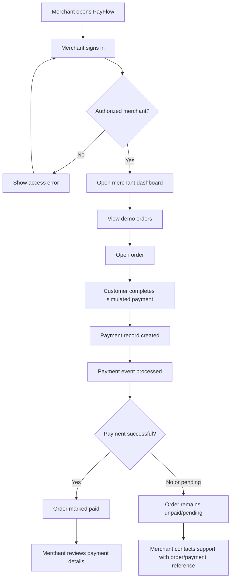

# PayFlow Merchant User Journey

**Document ID:** PF-UJ-MER-001  
**Version:** 1.0

## 1. Persona

**Business:** Green Basket (fictional demo merchant)  
**Role:** Merchant operator  
**Goal:** Create/inspect a demo order, receive a simulated payment and confirm the order status.

## 2. Happy-path journey

## 3. Step-by-step journey

| Step | Merchant action | Expected behaviour | Support evidence |
|---|---|---|---|
| 1 | Signs in | Merchant authentication succeeds | Auth response |
| 2 | Opens dashboard | Only the merchant's own data is shown | Authorization and query evidence |
| 3 | Reviews orders | Orders and statuses are listed | Orders API response |
| 4 | Opens an order | Order detail and amount are displayed | Order ID and database record |
| 5 | Customer pays | Simulated payment attempt is created | Payment reference |
| 6 | Payment event is processed | Order status is updated according to payment outcome | Event record and application log |
| 7 | Merchant checks status | Paid/pending/failed status is visible | Payment and order records |
| 8 | Merchant reports mismatch | Support ticket is created | Ticket ID, order ID and payment reference |

## 4. Merchant exception scenarios

### A. Payment successful but order remains pending
- L1 collects order ID, payment reference, amount and time.
- L1 confirms the merchant is viewing the correct order and checks for a known incident.
- L2 compares payment status with order status and checks event delivery/processing logs.
- Engineering escalation is appropriate if application code or event processing requires a code change.

### B. Merchant cannot see an order
- L1 confirms the order reference and merchant account.
- L2 checks merchant ownership, order creation and API query filters.
- Do not disclose another merchant's data.

### C. Merchant dashboard totals differ from transaction list
- L1 captures the filters/date range and displayed figures.
- L2 checks date boundaries, status filters, currency handling, aggregation logic and source records.
- Reconcile using read-only queries before recommending a correction.

## 5. Merchant data and security rules

- Merchants can access only their own orders and associated payment information.
- Merchant users must not see customer passwords, wallet PINs or authentication tokens.
- Support staff should verify the merchant identity and authorization before discussing account-specific details.
- Screenshots used as evidence must use synthetic data and redact secrets.

## 6. Journey success criteria

- Merchant can sign in and access only its own records.
- Order and payment statuses are consistent with the simulated payment outcome.
- Each payment can be traced using a unique reference.
- A status mismatch can be investigated using order, payment, event and log evidence.
