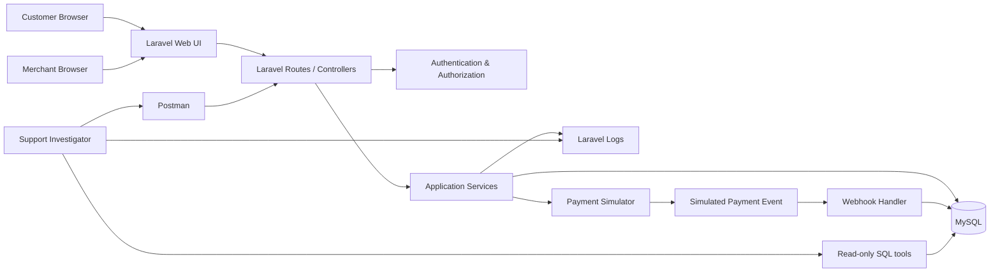

# PayFlow Logical Architecture — Day 1

## 1. High-level view

## 2. Component responsibilities

### Browser/UI
- Presents customer and merchant pages.
- Sends requests to Laravel.
- Displays safe user-facing messages.
- Does not make authorization decisions on its own.

### Laravel application
- Authenticates users.
- Authorizes access to customer/merchant-owned resources.
- Validates inputs.
- Executes wallet and transaction business rules.
- Writes database changes in transactions.
- Produces structured logs and request IDs.

### MySQL
- Stores users, wallets, transactions, ledger entries, merchants, orders, payments, webhook events and audit records.
- Enforces primary keys, foreign keys and unique references where appropriate.

### Payment simulator
- Produces controlled success, pending and failed outcomes.
- Does not contact a live provider.
- Uses synthetic provider references.

### Webhook handler
- Receives simulated payment events.
- Validates event identity and payload.
- Prevents duplicate processing.
- Records delivery and processing outcomes.

### Support toolset
- Postman reproduces API behaviour.
- SQL client performs approved read-only investigations.
- Laravel logs provide diagnostic context.
- Ticket system records customer impact, findings and ownership.

## 3. Request traceability

A support investigation should be able to connect:

`Ticket ID → customer/merchant → request ID → transaction/order reference → database records → application log entries`

Do not log credentials, passwords, PINs, full tokens or sensitive payment data.

## 4. Local development environment

Initial target:

- Windows
- XAMPP Apache
- XAMPP MySQL/MariaDB service
- PHP version compatible with selected Laravel release
- Composer
- Git
- Postman
- Browser developer tools

The Laravel development server (`php artisan serve`) may be used during development instead of Apache virtual-host configuration. The database can still be the XAMPP-managed MySQL/MariaDB service.

## 5. Architecture decisions to validate later

- Laravel version based on actual PHP/Composer environment.
- Authentication approach suitable for a local API lab.
- Exact schema and indexes.
- Transaction and ledger design.
- Request ID middleware.
- Logging format and redaction.
- Webhook signature simulation and idempotency strategy.
